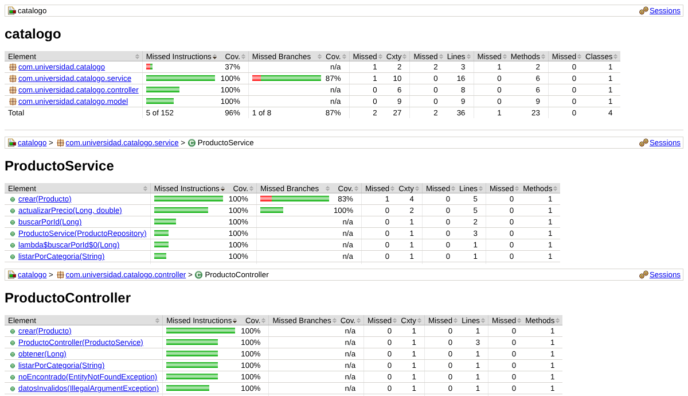
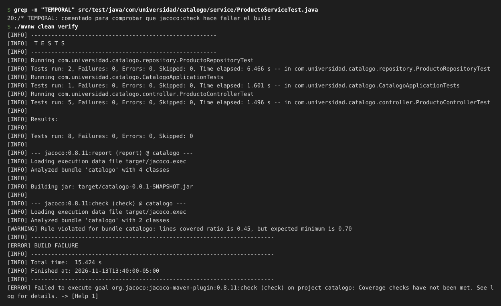
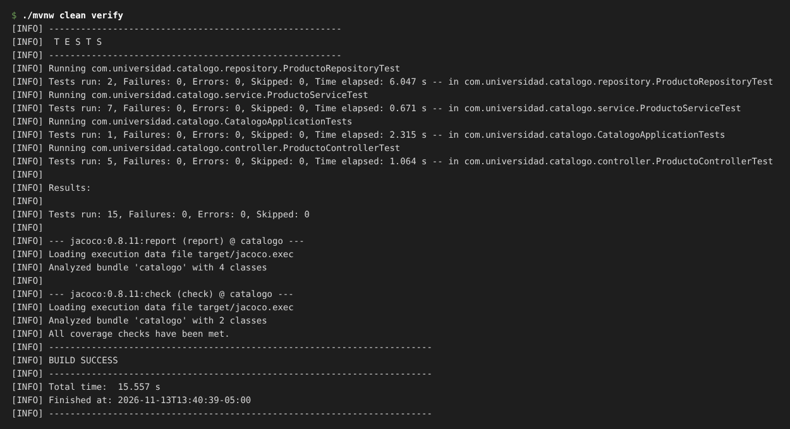
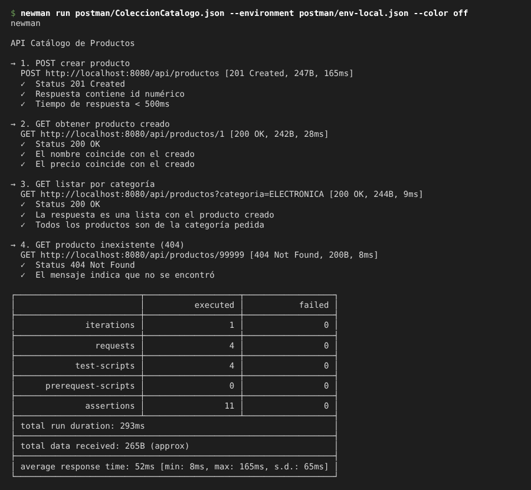

# Post-contenido — Unidad 10: Pruebas de Software en Aplicaciones Web

## Descripción
Repositorio del laboratorio de la Unidad 10 de Programación Web —
Séptimo Semestre. Contiene un único proyecto Maven Spring Boot
(catalogo-productos/) con una suite de pruebas unitarias, de
integración y de capa web sobre un catálogo de productos, más una
colección Postman versionada y un umbral de cobertura verificado
con JaCoCo.

Estructura:
```
catalogo-productos/
├── src/main/java/com/universidad/catalogo/
│   ├── model/Producto.java
│   ├── repository/ProductoRepository.java
│   ├── service/ProductoService.java
│   └── controller/ProductoController.java
└── src/test/java/com/universidad/catalogo/
    ├── service/ProductoServiceTest.java        (unitarias, Mockito)
    ├── repository/ProductoRepositoryTest.java  (integración, @DataJpaTest + H2)
    └── controller/ProductoControllerTest.java  (capa web, @WebMvcTest + MockMvc)
postman/
├── ColeccionCatalogo.json   (4 requests con test scripts)
└── env-local.json           (entorno Catalogo-Local, baseUrl)
```

## Parte 1 — Pruebas Unitarias con Mockito y de Integración con @DataJpaTest
ProductoServiceTest usa Mockito (@Mock, @InjectMocks) para probar
la lógica de negocio en aislamiento, cubriendo el caso feliz y dos
casos de error (precio inválido, producto no encontrado).
ProductoRepositoryTest usa @DataJpaTest con H2 en memoria para
probar las consultas del repositorio.

### Propósito de cada clase de prueba
- **ProductoServiceTest (7 tests)** — `@ExtendWith(MockitoExtension.class)`:
  el repositorio es un `@Mock`, así que solo se prueba la lógica del
  servicio (validaciones y decisiones), sin base de datos ni Spring.
  Cubre crear válido, precio negativo, nombre vacío, id inexistente
  (`EntityNotFoundException` con `assertThrows`), listar por categoría
  y actualizar precio (válido y en cero). En los casos de error se
  verifica con `verify(repo, never()).save(any())` y
  `verifyNoInteractions(repo)` que el repositorio nunca se llamó.
- **ProductoRepositoryTest (2 tests)** — `@DataJpaTest` +
  `TestEntityManager`: aquí sí interesa la base de datos real (H2), porque
  lo que se prueba es que la consulta derivada `findByCategoria`
  funcione. Cada test corre en una transacción que se revierte, así que
  `setUp()` puede insertar los mismos dos productos sin acumularlos.

## Parte 2 — Pruebas Web con @WebMvcTest, Postman/Newman y JaCoCo
ProductoControllerTest usa @WebMvcTest con MockMvc para probar la
capa web sin levantar el contexto completo. La colección Postman
"API Catálogo de Productos" (postman/ColeccionCatalogo.json)
ejecuta 4 requests con test scripts contra la aplicación en
ejecución real, y puede correrse también con
`newman run postman/ColeccionCatalogo.json --environment postman/env-local.json`.
JaCoCo verifica una cobertura mínima del 70% de líneas sobre todo
el módulo con `mvn verify`.

- **ProductoControllerTest (5 tests)** — `@WebMvcTest(ProductoController.class)`
  con `@MockBean ProductoService`: solo carga la capa web y simula las
  peticiones HTTP sin abrir un puerto. Verifica 200 (GET por id y GET por
  categoría), 404 (producto no encontrado), 201 (POST válido) y 400
  (precio inválido), además del JSON con `jsonPath`.
- **Colección Postman (4 requests, 11 assertions)** — POST crear
  (201, id numérico que se guarda en `productoId`, tiempo < 500 ms),
  GET por id (200, nombre y precio), GET por categoría (200, la lista
  incluye el producto creado y todos son de la categoría pedida) y GET
  inexistente (404 con el mensaje "Producto no encontrado").

### Orden en que se agregaron los tipos de prueba
1. Unitarias del servicio (lo más rápido y aislado, base de la pirámide).
2. Integración del repositorio con H2.
3. Capa web con MockMvc, cuando ya existía el controlador.
4. Colección Postman como prueba de extremo a extremo sobre la API real.
5. JaCoCo al final, para medir la cobertura de las tres capas juntas.

### Resultados
- `./mvnw clean verify`: 15 tests en verde (7 servicio, 2 repositorio,
  5 controlador y el `contextLoads` que trae el proyecto) y
  `All coverage checks have been met`.
- Cobertura de líneas que mide `jacoco:check` (sin `*Application` ni
  `model`): 24 de 24 líneas, 100%. El reporte completo da 96% de
  instrucciones (solo queda sin cubrir el `main` de la aplicación).
- Newman: 4 requests, 11 assertions, 0 failures.
- **Prueba del umbral:** primero se comentó ProductoControllerTest y el
  build *siguió pasando* (79%), porque el controlador solo tiene 8
  líneas y el servicio (16 líneas) seguía cubierto. Para comprobar que
  el gate sí funciona se comentó ProductoServiceTest: la cobertura bajó
  a 45% y `mvn verify` falló con
  `Rule violated for bundle catalogo: lines covered ratio is 0.45, but expected minimum is 0.70`.
  Después se restauró el archivo y el build volvió a pasar.

## Decisiones de diseño
1. H2 se usa también para ejecución local (no solo pruebas): el
   objetivo de la unidad es la escritura de pruebas, no el modelado
   de persistencia contra un motor externo como en la Unidad 8.
2. buscarPorId lanza EntityNotFoundException en vez de retornar
   null, para que el contrato del método sea explícito y verificable
   con assertThrows.
3. ProductoRepositoryTest usa @DataJpaTest en vez de @SpringBootTest
   para aislar la prueba a la capa de persistencia y mantener la
   suite rápida.
4. ProductoControllerTest usa @WebMvcTest en vez de @SpringBootTest
   con TestRestTemplate, para no duplicar cobertura con las pruebas
   de servicio y repositorio ya existentes.
5. La colección Postman se versiona como archivo .json, no como
   test JUnit, porque prueba el contrato HTTP completo como caja
   negra contra un proceso real, un nivel distinto al de MockMvc.
6. JaCoCo se configura al cierre de la Parte 2, no de la Parte 1,
   para medir la cobertura agregada de las tres capas y evitar que
   el umbral del 70% se cumpla artificialmente sobre una suite
   incompleta.
7. Este laboratorio NO incluye Selenium WebDriver: el dominio es una
   API REST pura sin vista Thymeleaf, y fabricar una vista solo para
   justificar Selenium contradiría la pirámide de pruebas. La
   colección Postman cumple el rol de prueba de extremo a extremo
   sobre la superficie real de la aplicación. En un proyecto con
   formularios Thymeleaf (como el catálogo de la Unidad 8) sí se usaría
   Selenium con Page Object Model para el flujo de crear un producto.

## Cómo compilar y ejecutar
1. Clonar el repositorio: `git clone https://github.com/DanielUsopp/Mena-post1-U10.git`
2. Ejecutar `./mvnw spring-boot:run` dentro de catalogo-productos/
3. Ejecutar la suite completa con verificación de cobertura:
   `./mvnw clean verify` (genera el reporte JaCoCo en
   target/site/jacoco/index.html y falla si la cobertura < 70%)
4. Con la aplicación en ejecución, correr la colección Postman:
   `newman run postman/ColeccionCatalogo.json --environment postman/env-local.json`
   (o importar los dos archivos en Postman y usar el Collection Runner)

Requisitos: Java 17 o 21 y, para Newman, Node.js 18+ (`npm install -g newman`).

## Capturas de pantalla




